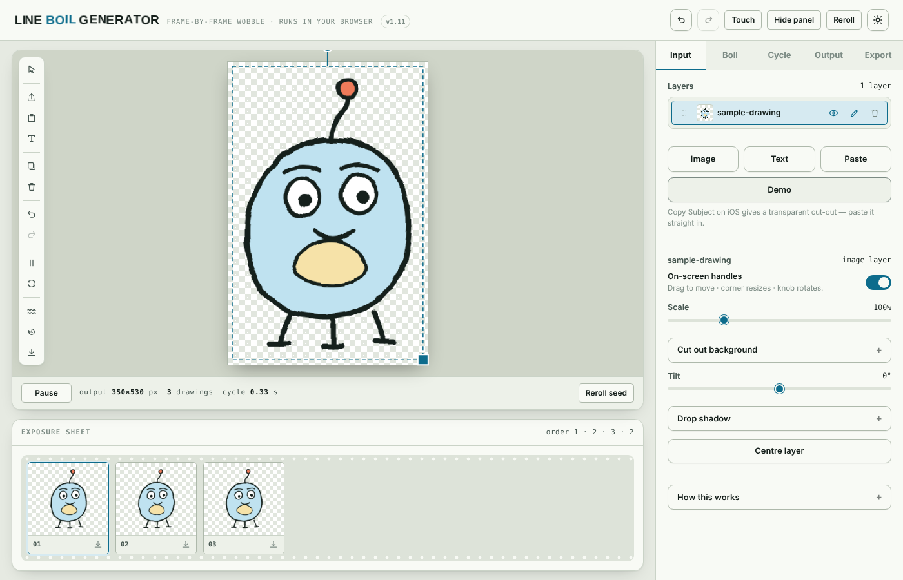

https://github.com/user-attachments/assets/477ba39f-adc7-470d-8efb-db1f6809418d

# Line Boil Generator

[Launch Line Boil Generator app](https://dougalder.github.io/line-boil-gen/)

Transform a single drawing or cutout into a mesmerizing boiling animation cycle. Everything runs in your browser—no installation required, no network calls (except for fonts), completely offline once loaded.

## Features

- **Zero Dependencies**: Pure JavaScript with no frameworks, libraries, or build steps
- **Multiple Drawings**: Layer up to 12 images, text, or drawings
- **Boiling Effects**: Six procedural distortion effects (jitter, warp, ripple, tremble, swell, drift)
- **Text Support**: Add text in multiple fonts and sizes with fill and outline colors
- **Background Removal**: Automatic alpha-channel extraction from plain backgrounds
- **Rich Editing**: Resize, move, rotate, and tilt layers with on-screen handles
- **Multiple Exports**:
  - GIF (animated, optimized palette)
  - APNG (lossless animation)
  - PNG sequences (for frame-by-frame editing)
  - MP4 (H.264 video)
  - WebM (VP9 video)
  - Green-screen video (transparent background)
- **Full Undo/Redo**: 40-level history with automatic coalescing
- **Responsive Design**: Works on desktop, tablet, and mobile
- **Offline**: Load once, work without internet (except initial font load)

## Getting Started

1. Open `index.html` in any modern browser
2. Click **Demo** to load a sample image and see the animation in action
3. Upload your own image or use **Paste** to add clipboard content
4. Customize with text, colors, effects, and boiling parameters
5. Export in your preferred format

## Usage

### Input Tab
- **Import**: Upload images or graphics
- **Paste**: Add clipboard content as a new layer
- **Text**: Add text with customizable fonts, sizes, and colors
- **Layers**: View and manage all layers with visibility and deletion controls

### Boil Tab
- **Effect**: Choose from Jitter, Warp, Ripple, Tremble, Swell, or Drift
- **Intensity**: Adjust effect strength (0–100)
- **Scale**: Control effect frequency (10–200)
- **Seed**: Randomize the effect pattern
- **Variations**: Generate 1–12 different animation cycles

### Output Tab
- **Length**: Set animation duration in frames
- **Frame Rate**: Choose animation speed (8–60 fps)
- **Trim to Artwork**: Crop excess transparent pixels
- **File Size Estimates**: Preview GIF, APNG, MP4, and WebM sizes

### Export Tab
- **GIF**: Optimized 8-bit palette with transparency support
- **APNG**: Full-color lossless animation
- **PNG Frames**: Individual frames for post-processing
- **MP4**: H.264 video (green-screen option available)
- **WebM**: VP9 video

## Technical Details

### Hand-Written Encoders
All animation encoders are custom implementations with no external dependencies:
- **GIF**: LZW compression with median-cut palette and transparency
- **APNG**: Full frame-control with delta optimization
- **MP4**: ISO-BMFF muxing with H.264 and WebCodecs
- **ZIP**: CRC32 and local/central directory for frame bundles
- **WebM**: MediaRecorder API wrapper

### Browser Compatibility
Works in all modern browsers with Canvas 2D, Web Workers, and MediaRecorder support:
- Chrome/Edge 90+
- Firefox 88+
- Safari 14+ (macOS), 15+ (iOS)
- Opera 76+

### Performance
- Layer caching with content-signature keying
- Vectorized value-noise distortion engine
- Incremental canvas compositing
- WebWorker support for long encodes

## Fonts

The application uses the following Google Fonts (all under the SIL Open Font License 1.1):
- Archivo (Sans-Serif, 600–800 weights)
- Asap (Sans-Serif, 400–700 weights)
- Azeret Mono (Monospace, 400–600 weights)
- Bangers (Display)
- Permanent Marker (Display)
- Caveat (Handwriting)
- Fredoka (Sans-Serif)
- Bungee (Display)
- Alfa Slab One (Display)
- Playfair Display (Serif)
- Special Elite (Display)

System fonts (Georgia, Impact) are also available and render without network requests.

## License

MIT License – see `LICENSE` file for details.

For third-party font licensing, see `THIRD-PARTY-LICENSES.md`.

## Tips & Tricks

- **Tight Exports**: Use the "Trim to Artwork" option to remove excess transparent pixels
- **Green Screen**: Select the green-screen option in Export to create videos with transparency
- **Text Layers**: Text is rasterized at export time, so you can scale and rotate without quality loss
- **Background Removal**: Works best with solid-color backgrounds; use Import for semi-transparent cutouts
- **Large Images**: The app works with any image size, but very large images may take longer to process
- **Frame Counts**: Fewer frames = smaller files and faster exports; start with the default and increase if needed

## Troubleshooting

**Fonts not loading**: The application uses Google Fonts; if you're offline after the initial load, fonts will fall back to system defaults (Serif, Sans-Serif, Monospace).

**Slow exports on large images**: Processing is done on the CPU; close other browser tabs to free memory.

**Video export issues**: MP4 export requires the WebCodecs API; WebM is available as a fallback.

**Transparency not working**: Ensure the original image has an alpha channel or use the background-removal tool.

## Feedback & Contributions

This is a standalone tool maintained as-is. For bug reports or feature requests, please open an issue on GitHub.

---

Built with care, zero external libraries, works anywhere.
