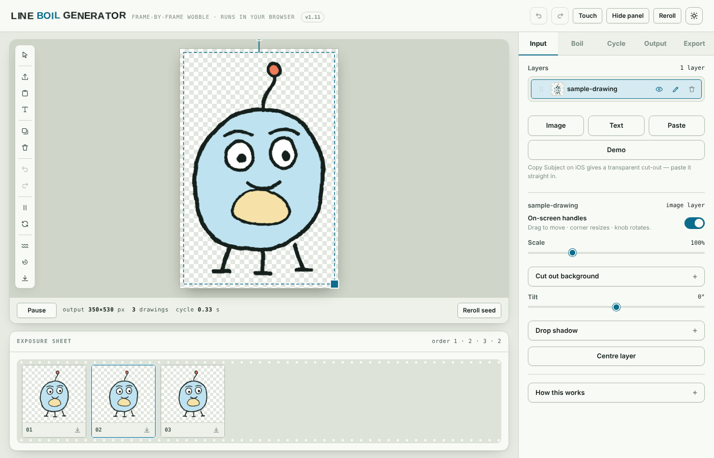
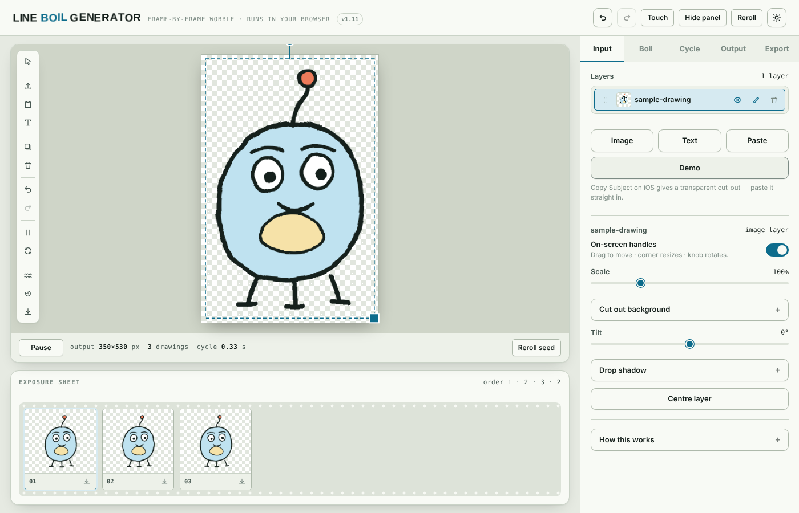
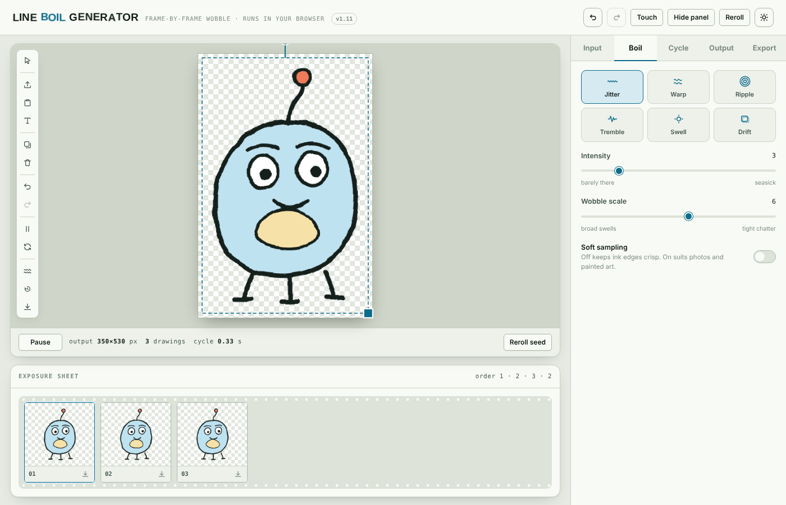
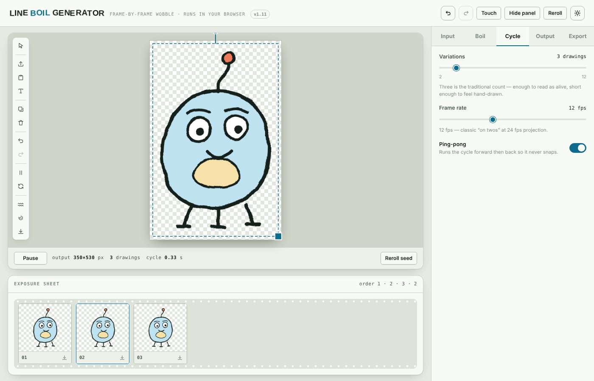
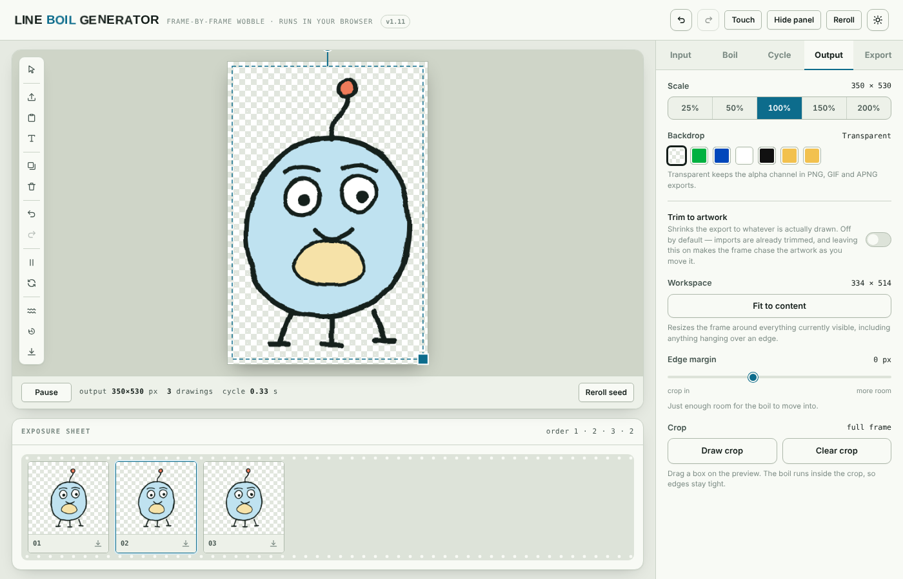

# Line Boil Generator – User Manual

## Introduction

Line Boil Generator is a web-based animation studio for creating boiling, shimmering, and distortion effects on artwork. Load an image, customize it, and export as GIF, APNG, PNG frames, or video.

**No installation. No login. No internet required after the first load.**

## First Look

When you open the application, you'll see:
- A large **Preview Canvas** on the left (the workspace for your art)
- A **Toolbar** floating above the preview (with buttons for import, text, undo, etc.)
- A **Tabbed Control Panel** on the right (Input, Boil, Output, Export)



## Loading Your Work

### Demo
Click the **Demo** button in the toolbar to load a sample image. This is a good way to explore the features without uploading anything.



### Import
Click the **Import** button (or drag and drop onto the canvas) to upload your own image. The app accepts:
- PNG (with or without transparency)
- JPEG
- GIF
- WebP
- Any image format your browser supports

Imported images are automatically trimmed to remove excess transparent pixels, with a 20-pixel margin preserved.

### Paste
Click **Paste** (or press Ctrl/Cmd+V) to add an image from your clipboard. This works especially well on iOS with the Copy Subject feature to extract transparent cutouts.

## The Input Tab

The Input tab is where you manage layers and add text.

### Layers

Every image or text element you add becomes a **layer**. Layers stack on top of each other in the order shown in the layers list.

Each layer has:
- **Visibility toggle** (eye icon) – hide/show without deleting
- **Layer preview** – small thumbnail
- **Layer name** – click to rename
- **Delete button** (×) – remove the layer

Drag layers to reorder them (top layer paints last, on top of everything).

### Adding & Editing Text

1. Click the **Text** button in the toolbar or the Input tab
2. Click in the preview canvas where you want the text
3. Type your text (the text box appears with a cursor ready)
4. Configure the text properties:
   - **Font**: Choose from 11 typefaces
   - **Size**: Adjust text height in pixels
   - **Fill Color**: Main text color
   - **Outline**: Toggle outline on/off
   - **Outline Color**: Color of the outline stroke

Text layers can be resized, moved, and rotated just like image layers.

### Layer Manipulation

When you select a layer, handles appear around it:
- **Corner handles** (resize): Drag to scale
- **Side handles** (move): Drag to reposition
- **Rotation handle** (top center): Drag to rotate
- **Center dot** (move): Click and drag to move the entire layer

On touch devices, handles are larger and easier to control.

## The Boil Tab

The Boil tab controls the distortion effect applied to your animation.



### Effect Selection

Choose one of six procedural distortion effects:

- **Jitter**: Random displacement, like trembling water
- **Warp**: Smooth, flowing deformation
- **Ripple**: Concentric wave patterns
- **Tremble**: High-frequency oscillation, like vibration
- **Swell**: Bulging and shrinking motions
- **Drift**: Smooth directional flow

Each effect uses an underlying value-noise engine for smooth, organic motion.

### Parameters

- **Intensity** (0–100): How strong the distortion is
  - Low values (10–30): Subtle shimmer
  - Medium values (40–60): Noticeable wave
  - High values (70–100): Extreme deformation
  
- **Scale** (10–200): The size of the distortion pattern
  - Low values (10–40): Fine, detailed texture
  - Medium values (50–100): Balanced ripples
  - High values (120–200): Large, flowing patterns

- **Seed**: A random number that controls the distortion pattern
  - Each seed produces a unique animation
  - Click the **Reroll** button to generate a new seed

- **Variations** (1–12): How many different animation cycles to generate
  - The app generates N different random seeds, each producing a unique animation
  - Useful for animation studios that need variety

### Preview

The preview canvas shows the effect in real-time. Press the **Play/Pause** button to control playback.

## The Output Tab

The Output tab controls the animation parameters and frame settings.



### Animation Settings

- **Length** (frame slider): How many frames in one animation cycle
  - Fewer frames = smaller file size, faster playback
  - More frames = smoother animation
  - Range: 2–120 frames

- **Frame Rate** (fps slider): Animation speed in frames per second
  - 8 fps: Slow, dreamy motion
  - 24 fps: Film-like smoothness
  - 60 fps: Smooth, responsive
  - Range: 8–60 fps

### Output Options

- **Trim to Artwork**: If enabled, the exported animation is cropped to the smallest bounding box that contains all visible pixels. If disabled, the full canvas is exported.
  - Enabled = smaller files, no transparent margins
  - Disabled = preserves full workspace

- **File Size Estimates**: The app shows estimated file sizes for each format:
  - GIF: 8-bit indexed color, LZW compressed
  - APNG: Full-color, lossless
  - MP4: H.264 video
  - WebM: VP9 video

Larger dimensions and frame counts produce larger files.

## The Export Tab

The Export tab is where you download your animation.



### Export Formats

#### GIF
- **Best for**: Web, social media, broad compatibility
- **Color**: 8-bit indexed (256 colors)
- **Size**: Typically smallest
- **Speed**: Instant or very fast
- **Note**: Quality depends on palette optimization; works well for boiling effects

#### APNG
- **Best for**: Quality, transparency, lossless
- **Color**: Full 32-bit RGBA
- **Size**: Larger than GIF
- **Speed**: Fast
- **Support**: Chrome, Firefox, Safari
- **Note**: Perfect for archival or professional use

#### PNG Frames
- **Best for**: Frame-by-frame editing, post-processing
- **Format**: Individual PNG files (numbered 0001.png, 0002.png, etc.)
- **Delivery**: Zipped folder of PNGs
- **Size**: Largest (one file per frame)
- **Use case**: Import into Blender, After Effects, or other video software

#### MP4 (H.264 Video)
- **Best for**: Video platforms (YouTube, Vimeo), playback
- **Codec**: H.264 Baseline Profile (broad compatibility)
- **Size**: Medium, with quality/size tradeoff
- **Speed**: Fast to medium (depends on size)
- **Green Screen Option**: Export with transparent background (requires viewer support)

#### WebM (VP9 Video)
- **Best for**: High-quality web delivery, next-gen formats
- **Codec**: VP9
- **Size**: Can be smaller than MP4 for high quality
- **Speed**: Fast to medium
- **Support**: Chrome, Firefox, Edge (not Safari)

### Green Screen Mode

When exporting video (MP4 or WebM), enable **Green Screen** to export with a transparent background instead of a solid color. This is useful for:
- Compositing into other videos
- Keying effects in video editing software
- Creating foreground elements

The transparent areas appear as black in the video player, but will be transparent when imported into a video editor that supports it.

### Download

Click the button for your desired format. The browser downloads the file with a timestamped name:
```
YYYY-MM-DD Line Boil Generator-[Effect Name]-[WIDTHxHEIGHT].[ext]
```

Example: `2024-10-25 Line Boil Generator-Ripple-800x600.gif`

## Keyboard Shortcuts

| Shortcut | Action |
|----------|--------|
| Cmd/Ctrl+Z | Undo |
| Cmd/Ctrl+Shift+Z | Redo |
| Cmd/Ctrl+V | Paste from clipboard |
| Spacebar | Play/Pause animation |

## Tips for Best Results

### Artwork Preparation
- **Solid backgrounds**: For best background removal, use a plain, uniform background color
- **Transparent backgrounds**: PNG files with alpha channels work great – import directly
- **File size**: Start with images under 2MB; very large images take longer to process

### Effect Settings
- **Subtle effects**: Intensity 20–40, Scale 60–100 (for delicate shimmer)
- **Dramatic effects**: Intensity 70–100, Scale 150–200 (for dynamic motion)
- **Organic look**: Combine different seeds and reroll until you find one you like

### Performance
- Avoid very large images combined with high frame counts
- For quick exports, use fewer frames (20–40)
- Close other browser tabs to free memory for processing

### Exporting for Different Use Cases

**Social Media (Twitter, Instagram)**
- Format: GIF
- Size: Keep under 5MB
- Duration: 10–20 frames at 12 fps for instant load

**Web Animation (Website, Blog)**
- Format: MP4
- Size: 800–1200 pixels wide
- Frame count: 30–60 frames at 24 fps

**Print-Ready Frames**
- Format: PNG Frames
- Resolution: 300+ dpi equivalent
- Frames: 4–8 for a short loop

**Video Compositing**
- Format: MP4 (green screen) or PNG frames
- Resolution: Match your project frame size
- Frame rate: 24 fps or 30 fps

## Troubleshooting

### Fonts Look Different in Export
The application uses Google Fonts for the best appearance. If you export on a system without internet or in a browser that blocks external fonts, the text will render in system fonts (Serif, Sans-Serif, Monospace). This is normal and doesn't affect the animation itself.

### "Processing took too long" Message
Large images or high frame counts can take a minute or two to encode. This is expected. If the encoding truly hangs (> 5 minutes), try:
1. Reducing the image size
2. Lowering the frame count
3. Closing other browser tabs
4. Refreshing and trying a smaller export

### Green Screen Video Not Transparent
If you export as MP4 with green screen enabled, the transparency will only work if:
- Your video editor supports the video codec (H.264 in MP4)
- You import the video into a tool that can interpret transparency (most professional video editors can)
- Some online players may not support transparency; test with your target platform

### Undo/Redo Not Working
The app supports 40 levels of undo. If you've performed more than 40 actions, the oldest ones are cleared from history. This is normal.

## Version Information

**Current Version**: 1.11

**Release Date**: October 2024

**Last Updated**: See CHANGELOG.md for detailed version history

---

Built entirely in JavaScript with custom encoders and zero external dependencies. All processing happens in your browser.
